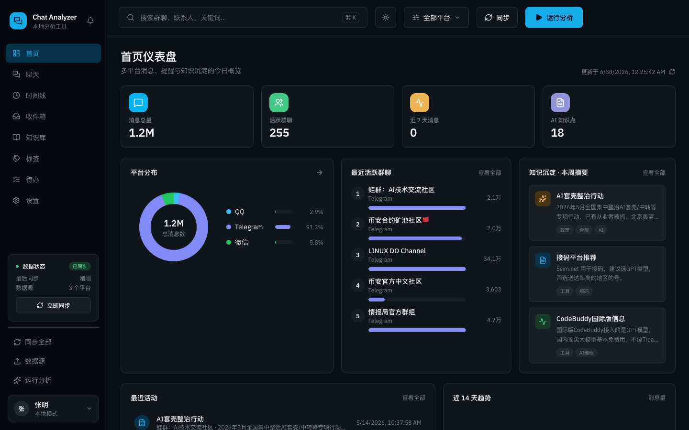
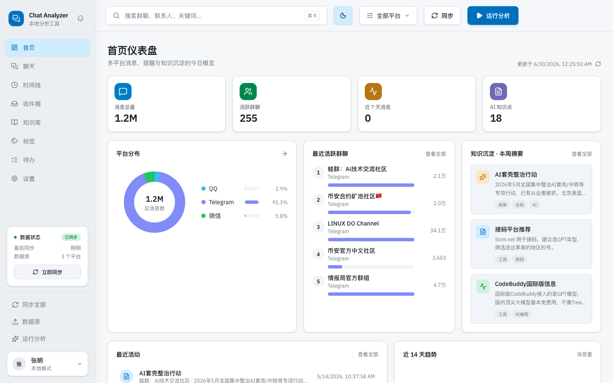
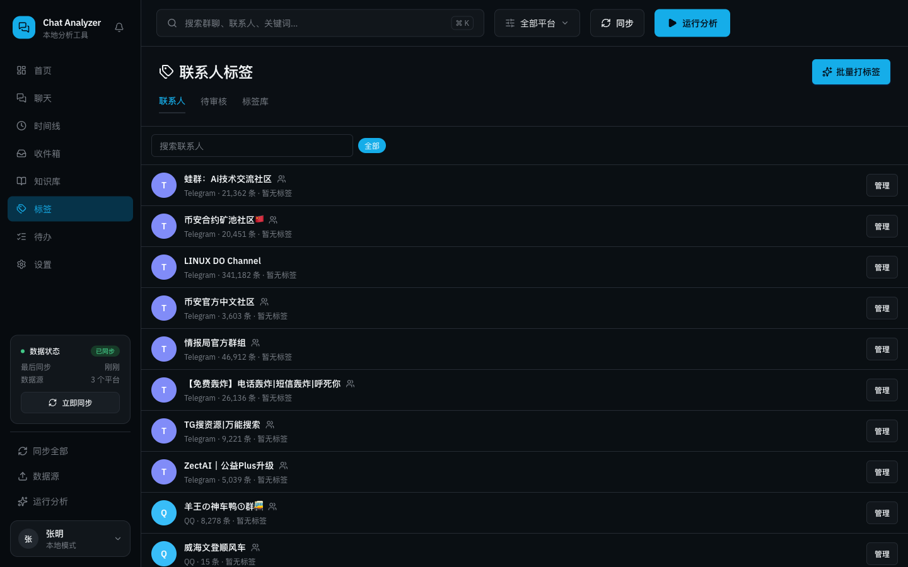
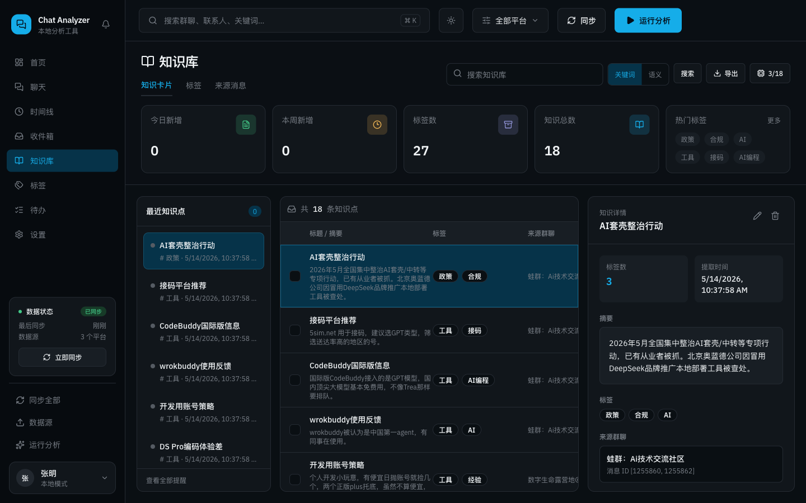

# Chat Analyzer

[中文](README.md) · **English**

> A local-first tool that aggregates your WeChat / QQ / Telegram chat history into one SQLite database and uses an LLM to extract knowledge, tag contacts, and surface to-dos — entirely on your machine. The AI only suggests; you decide.



---

## ✨ Features

- **Multi-platform aggregation** — WeChat (wx-cli), QQ (NapCat + QCE), and Telegram (Telethon account API) messages land in a single SQLite database; platform is just a column, not a silo.
- **LLM analysis pipeline** — split into conversation windows → in-window denoising → per-window extraction (knowledge / todo + urgency) → overall summary. Truly incremental: per-chat `analysis_state` checkpoints advance even on zero-yield runs and drain backlogs across runs; results persist in a review-batch table (restart-safe), nothing is saved until you confirm, and rejected items feed back into the prompt as negative examples.
- **Knowledge base** — keyword / semantic search (embeddings, numpy-ranked), related-item recommendations, AI expansion, editing, Markdown export; exact + semantic dedup at save time, auto-embedding on save, stale-vector invalidation on edit, batch-level undo.
- **Contact tagging** — the LLM reads a contact's history and auto-tags them (single / batch / scheduled), combining a preset tag library with free-form AI suggestions; pending-review queue, group insights, and one-click "add to denoise allowlist." Cross-platform, in-app only, never written back to WeChat.
- **Cross-platform identity** — `contact_aliases` maps per-platform accounts to one person; VIP allowlisting resolves through aliases so display-name changes don't break it.
- **To-do board + reminders** — aggregates to-dos produced by analysis, sorted by urgency with check-off completion; optional scheduled macOS reminders for open urgent items.
- **Triggers + inbox** — keyword triggers (FTS5 full-text index) plus semantic triggers ("notify me when people talk about renovations"); matches land in an inbox with macOS notifications.
- **Scheduler** — sync (WeChat / QQ / Telegram, serialized against DB contention), auto-analyze, auto-tag, and to-do reminders; run state lives in SQLite with uniform UTC timestamps.
- **Cool Slate design system** — a dark-first "cool terminal" UI with one-click dark / light theme switch, monospace for IDs / timestamps / numbers, and a same-hue chart ramp.
- **Security & usage** — binds `127.0.0.1` by default with an optional API token (required for LAN exposure); config file at `0600` perms with secrets redacted; daily token budget with in-flight reservations, embedding accounting, and per-task attribution; automatic SQLite backups.

## 🖼 Screenshots

| Dashboard (dark) | Dashboard (light) |
|---|---|
|  |  |

| Contact tags | Knowledge base |
|---|---|
|  |  |

## 🧱 Tech stack

| Layer | Tech |
|---|---|
| Backend | Python 3.12 · FastAPI · Uvicorn · aiosqlite · httpx |
| Frontend | React 18 · TypeScript · Vite · Tailwind CSS v4 · shadcn-style components · Recharts |
| LLM | Claude CLI (`claude -p`) / Codex CLI / OpenAI-compatible API (LM Studio · Ollama) |
| Database | SQLite (`~/.chat-analyzer/data/chat.db`) |
| Connectors | WeChat: wx-cli ｜ QQ: NapCat + qq-chat-exporter ｜ Telegram: Telethon |

## 🚀 Quick start

Prerequisites: Python 3.12, Node 18+, and at least one working LLM backend (an authenticated Claude CLI, or a local LM Studio / Ollama).

```bash
# 1. Backend
cd backend
python -m venv .venv && source .venv/bin/activate
pip install -e .
python -m uvicorn app.main:app --host 127.0.0.1 --port 8000
# For LAN access: set an API token in Settings → General first, then use --host 0.0.0.0

# 2. Frontend (dev, hot reload)
cd frontend
npm install
npm run dev          # http://localhost:5173

# Or: build and let the backend serve it on a single port
npm run build        # then open http://localhost:8000
```

Connect data sources (WeChat / QQ / Telegram) and pick an LLM under **Settings → Data Sources / AI Model**. See the [Chinese project guide](chat-analyzer-项目说明.md) for full details.

## 🗂 Data storage

| What | Path |
|---|---|
| Database | `~/.chat-analyzer/data/chat.db` |
| Config (`0600` perms) | `~/.chat-analyzer/config.json` |

> The config holds API keys / QQ token / Telegram session and lives **in your home directory, outside the repo** — it never enters git.

## 🔒 Privacy

Runs entirely on your machine: messages, config, and analysis results never leave your computer, and you can use local models (LM Studio / Ollama) to stay fully offline. All AI output passes through human review before it is saved.

## 📄 Docs

- [`chat-analyzer-项目说明.md`](chat-analyzer-项目说明.md) — architecture, data flow, full API endpoints, setup (Chinese)
- [`PROJECT.md`](PROJECT.md) — earlier project notes

## License

[MIT](LICENSE)
