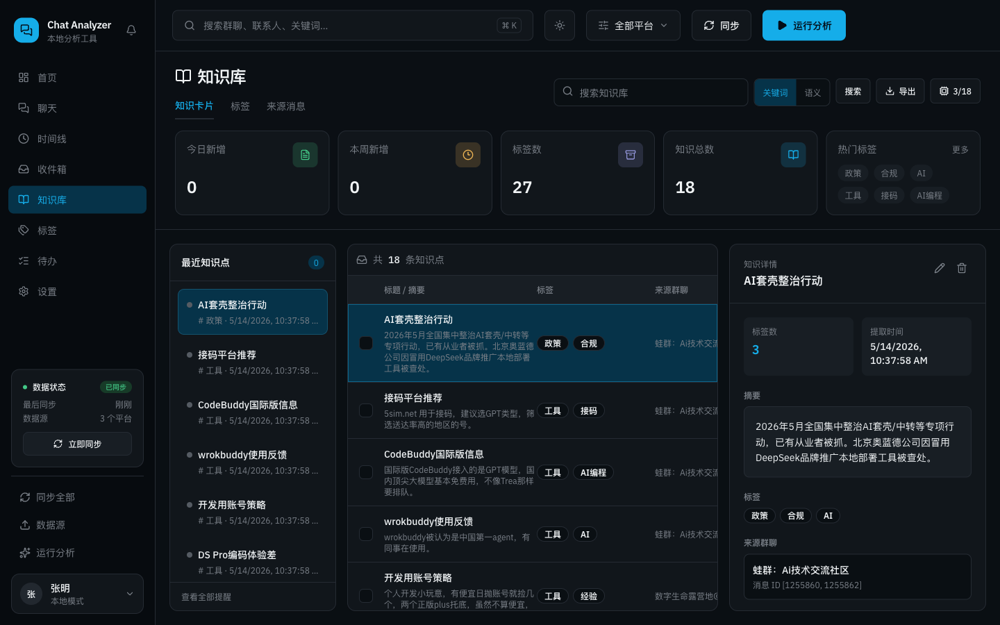

# Chat Analyzer · 聊天记录智能分析系统

**中文** · [English](README.en.md)

> 本地优先的多平台（微信 / QQ / Telegram）聊天记录聚合 + AI 分析工具。所有数据落在本地，AI 只做建议、用户做决策。

A local-first tool that aggregates your WeChat / QQ / Telegram chat history into one SQLite database and uses an LLM to extract knowledge, tag contacts, and surface to-dos — entirely on your machine.


---

## ✨ 功能特性

- **多平台聚合** —— 微信（wx-cli）、QQ（NapCat + QCE）、Telegram（Telethon 账号 API）的消息统一进一个 SQLite，平台只是字段不是孤岛。
- **LLM 分析流水线** —— 时间窗切分 → 窗口内去噪 → 逐窗提取（knowledge / todo + 紧急度）→ 整体摘要。真增量：`analysis_state` 检查点表按会话推进，积压分批消化、零产出也推进；结果持久化进待审核批次表（重启不丢），用户勾选确认才入库，被拒条目回流为提取 prompt 的负例。
- **知识库** —— 关键词 / 语义搜索（Embedding，numpy 排序）、关联推荐、AI 扩展、编辑、导出 Markdown；保存时精确 + 语义去重，入库自动增量 embed，编辑自动失效重建；支持批次级撤销。
- **联系人标签** —— AI 读取聊天记录自动给好友打标签（单个 / 批量 / 定时），预设标签库 + AI 自由补充结合；待审核池、群体洞察、一键加入去噪白名单。跨平台、纯应用内、不写回微信。
- **跨平台身份合并** —— `contact_aliases` 把多平台账号映射到同一个人，VIP 白名单经别名解析，改昵称不失效。
- **待办看板 + 提醒** —— 聚合分析产出的待办，按紧急度排序、可勾选完成；可定时提醒逾期未完成的紧急待办（macOS 通知）。
- **触发器 + 收件箱** —— 关键词触发（FTS5 全文索引加速）+ 语义触发（“聊到装修相关就通知我”），命中进收件箱，配 macOS 通知。
- **定时任务** —— 同步（微信 / QQ / Telegram，串行防锁）、自动分析、自动打标签、待办提醒；运行状态存 SQLite，统一 UTC，时间不漂移。
- **Cool Slate 设计系统** —— 冷峻终端风的深色为主界面，深 / 浅双主题一键切换，ID / 时间戳 / 数值用等宽字体，图表同色相阶梯。
- **安全与用量** —— 默认只绑 `127.0.0.1`，可选 API Token（局域网暴露必设）；配置文件 `0600` 权限、敏感字段脱敏返回；每日 Token 预算含在途预留与 embedding 记账，按任务归因；SQLite 自动备份。

## 🖼 界面预览

| 仪表盘（深色） | 仪表盘（浅色） |
|---|---|
|  |  |

| 联系人标签 | 知识库 |
|---|---|
|  |  |

## 🧱 技术栈

| 层 | 技术 |
|---|---|
| 后端 | Python 3.12 · FastAPI · Uvicorn · aiosqlite · httpx |
| 前端 | React 18 · TypeScript · Vite · Tailwind CSS v4 · shadcn 风格组件 · Recharts |
| LLM | Claude CLI（`claude -p`）/ Codex CLI / OpenAI 兼容 API（LM Studio · Ollama）|
| 数据库 | SQLite（`~/.chat-analyzer/data/chat.db`）|
| 微信 | wx-cli ｜ QQ | NapCat + qq-chat-exporter ｜ Telegram | Telethon |

## 🚀 快速开始

前置：Python 3.12、Node 18+，以及至少一个可用的 LLM 后端（Claude CLI 已认证，或本地 LM Studio / Ollama）。

```bash
# 1. 后端
cd backend
python -m venv .venv && source .venv/bin/activate
pip install -e .
python -m uvicorn app.main:app --host 127.0.0.1 --port 8000
# 如需局域网访问：先在 设置 → 常规 配置 API Token，再改用 --host 0.0.0.0

# 2. 前端（开发模式，热更新）
cd frontend
npm install
npm run dev          # http://localhost:5173

# 或：构建后由后端单端口 serve
npm run build        # 然后访问 http://localhost:8000
```

### 双击启动（macOS）

```bash
scripts/make-launcher.sh     # 生成「Chat Analyzer.app」到 ~/Applications，可拖到 Dock
```

图标源文件 `assets/icon/icon.svg`。双击后在 Terminal 里起后端并自动打开 `http://127.0.0.1:8000`，首次运行会自动建虚拟环境、装依赖、构建前端；关闭窗口即停止。项目换目录后重跑一次该脚本。

数据源接入（微信 / QQ / Telegram）与 LLM 选择，在 **设置 → 数据源 / AI 模型** 页内完成，详见 [`chat-analyzer-项目说明.md`](chat-analyzer-项目说明.md)。

## 🗂 数据存储

| 内容 | 路径 |
|---|---|
| 数据库 | `~/.chat-analyzer/data/chat.db` |
| 配置（`0600` 权限） | `~/.chat-analyzer/config.json` |

> 配置文件含 API Key / QQ token / Telegram session，**保存在仓库之外的用户主目录**，不会进入 git。

- 换目录 / 换机器：把整个 `~/.chat-analyzer` 拷走，再用环境变量 `CHAT_ANALYZER_HOME=/新路径` 启动即可。
- 备份在 `~/.chat-analyzer/backups/`（同步前自动做，保留 5 份）。恢复：停服务 → `gunzip -c chat.db.<时间>.bak.gz > data/chat.db` → 重启；统计表会检测到数据回退并自动全量重建。
- **必须单进程运行**（不要 `uvicorn --workers N`，也不要重复启动）：任务进度、统计刷新锁都在进程内存里，第二个进程会被启动锁拒绝。

## 🔒 隐私

完全本地运行：消息、配置、分析结果都不离开你的机器；LLM 可选用本地模型（LM Studio / Ollama）做到全程离线。AI 产出一律先经用户审核才入库。

## 📄 文档

- [`chat-analyzer-项目说明.md`](chat-analyzer-项目说明.md) —— 架构、数据流、完整 API 端点、配置步骤
- [`PROJECT.md`](PROJECT.md) —— 早期版本说明

## License

[MIT](LICENSE)
