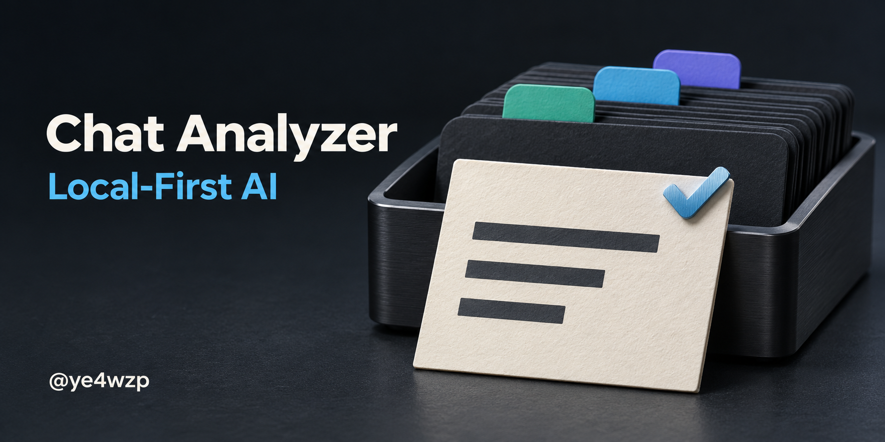
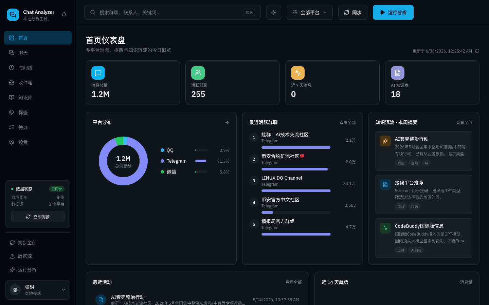
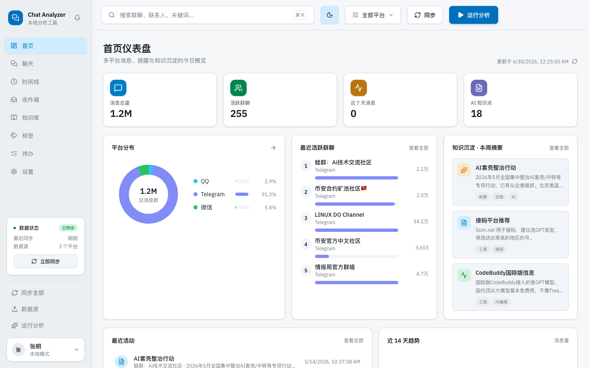
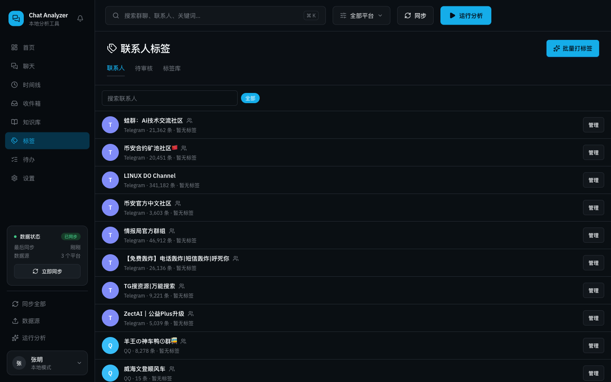

# Chat Analyzer · 聊天记录智能分析系统

**中文** · [English](README.en.md)


[](LICENSE)

> 本地优先的多平台（微信 / QQ / Telegram）聊天记录聚合 + AI 分析工具。所有数据落在本地，AI 只做建议、用户做决策。

A local-first tool that aggregates your WeChat / QQ / Telegram chat history into one SQLite database and uses an LLM to extract knowledge, tag contacts, and surface to-dos — entirely on your machine.

<p align="center"></p>

---

## ✨ 功能特性

- **多平台聚合** —— 微信（wx-cli）、QQ（NapCat + QCE 或 qq-cli 本地消息库）、Telegram（Telethon 账号 API）的消息统一进一个 SQLite，平台只是字段不是孤岛。
- **LLM 分析流水线** —— 时间窗切分 → 窗口内去噪 → 逐窗提取（knowledge / todo + 紧急度）→ 整体摘要。真增量：`analysis_state` 检查点表按会话推进，积压分批消化、零产出也推进；结果持久化进待审核批次表（重启不丢），用户勾选确认才入库，被拒条目回流为提取 prompt 的负例。
- **知识库** —— 关键词 / 语义搜索（Embedding，numpy 排序）、关联推荐、AI 扩展、编辑、导出 Markdown；保存时精确 + 语义去重，入库自动增量 embed，编辑自动失效重建；支持批次级撤销。
- **联系人标签** —— AI 读取聊天记录自动给好友打标签（单个 / 批量 / 定时），预设标签库 + AI 自由补充结合；待审核池、群体洞察、一键加入去噪白名单。跨平台、纯应用内、不写回微信。
- **以人为中心** —— `persons / person_identities` 把私聊、群内昵称、其他平台账号归到同一个人；档案页自动推荐候选身份，一键建档后能看到他在所有群里的发言足迹；VIP、预过滤都经身份解析，改昵称不失效。
- **入口即归一** —— 消息入库时就统一成跨平台类型 `kind`、记录时区偏移；同步范围可控（Telegram 频道默认不入库，任意聊天可标记不再同步），备份只带不可再生的资产表。
- **待办看板 + 提醒** —— 聚合分析产出的待办，按紧急度排序、可勾选完成；可定时提醒逾期未完成的紧急待办（macOS 通知）。
- **触发器 + 收件箱** —— 关键词触发（FTS5 全文索引加速）+ 语义触发（“聊到装修相关就通知我”），命中进收件箱，配 macOS 通知。
- **定时任务** —— 同步（微信 / QQ / Telegram，串行防锁）、自动分析、自动打标签、待办提醒；运行状态存 SQLite，统一 UTC，时间不漂移。
- **Cool Slate 设计系统** —— 冷峻终端风的深色为主界面，深 / 浅双主题一键切换，ID / 时间戳 / 数值用等宽字体，图表同色相阶梯。
- **安全与用量** —— 默认只绑 `127.0.0.1`，可选 API Token（局域网暴露必设）；配置文件 `0600` 权限、敏感字段脱敏返回；每日 Token 预算含在途预留与 embedding 记账，按任务归因；SQLite 自动备份。

## 🖼 界面预览

| 仪表盘（深色） | 仪表盘（浅色） |
|---|---|
|  |  |

| 联系人标签 | 知识库 |
|---|---|
|  |  |

## 🧱 技术栈

| 层 | 技术 |
|---|---|
| 后端 | Python 3.12 · FastAPI · Uvicorn · aiosqlite · httpx |
| 前端 | React 19 · TypeScript · Vite · Tailwind CSS v4 · shadcn 风格组件 · Recharts |
| LLM | Claude CLI（`claude -p`）/ Codex CLI / OpenAI 兼容 API（LM Studio · Ollama）|
| 数据库 | SQLite（`~/.chat-analyzer/data/chat.db`）|
| 数据源 | 微信：wx-cli ｜ QQ：NapCat + QCE / qq-cli 本地库 ｜ Telegram：Telethon |

## 🚀 快速开始

前置：Python 3.12、Node 18+，以及至少一个可用的 LLM 后端（Claude CLI 已认证，或本地 LM Studio / Ollama）。

```bash
# 1. 后端
cd backend
python -m venv .venv && source .venv/bin/activate
pip install -e .
python -m uvicorn app.main:app --host 127.0.0.1 --port 8000
# 如需局域网访问：先在 设置 → 常规 配置 API Token，再改用 --host 0.0.0.0

# 2. 前端（开发模式，热更新）
cd frontend
npm install
npm run dev          # http://localhost:5173

# 或：构建后由后端单端口 serve
npm run build        # 然后访问 http://localhost:8000
```

### 双击启动（macOS）

```bash
scripts/make-launcher.sh     # 生成「Chat Analyzer.app」到 ~/Applications，可拖到 Dock
```

图标源文件 `assets/icon/icon.svg`。双击后在 Terminal 里起后端并自动打开 `http://127.0.0.1:8000`，首次运行会自动建虚拟环境、装依赖、构建前端；关闭窗口即停止。项目换目录后重跑一次该脚本。

数据源接入（微信 / QQ / Telegram）与 LLM 选择，在 **设置 → 数据源 / AI 模型** 页内完成，详见 [`chat-analyzer-项目说明.md`](chat-analyzer-项目说明.md)。

## 🗂 数据存储

### 同步与证据核查（2026-10-26 更新）

- 微信数据源增加「同步新增」「全量读取」「检查历史补缺」。后两者都会回查历史、按消息标识去重，并读取 wx-cli 清单列出的已有解密缓存；不读取密钥。缓存中有记录不代表实时读取成功，无法核实的会话保持「待补」。仅能读取当前账号和本机可见历史。
- 三个平台统一显示成功、失败、待补会话及新增条数。顶部任务栏可展开明细，点击「继续未完成会话」重试；继续时保留已成功的会话，只重试失败、待补和未处理的会话。旧任务没有完整目标清单时会重新列出会话并跳过既有成功项，微信折叠分组自动排除。同步仍遵守设置中的排除范围。
- 同步任务保存在 `data/sync-tasks.db`，最多保留 200 条；进程重启后恢复为「中断」，由用户继续。任务记录保存失败会提示，损坏的日志不阻止主程序启动。该日志不含账号凭据。
- QQ 本地模式在「设置 → 数据源 → QQ」选择「本地数据库（qq-cli）」，填写账号和可读的 `nt_msg.db` 路径。首次同步读取已有私聊和群聊，之后按会话续读并回查最近一天。副本需由数据提供方更新。聊天列表可多选 QQ 会话补查更早的历史。
- QCE 分页使用固定结束时间，续传完成后再补截止点之后的新消息。首次使用新版本时，没有截止点的旧分页游标会安全回查；每轮仍有分页上限，未读完会显示待补。仅本机默认 QCE 地址使用当前受管理的凭据，远程地址保留其独立配置。
- Telegram 按消息 ID 从旧到新读取，每 200 条提交消息及进度；中断后从已提交位置恢复，限流时保留待补状态。
- 问答和搜索可按平台、会话 ID、日期限定范围。问答引用可展开前后文；同一秒的消息也保证包含命中项。知识检索遵守同一范围，来源不明或跨出范围的知识不会混入。
- 知识审核和详情页可以查看来源原文；同标题但内容或来源不同的经验、修正会保留。只有标题、内容、来源均相同才跳过，人工选中的条目不再因语义相似被静默丢弃。
- 搜索「加载更多」改为时间与消息 ID 游标，避免新消息插入导致结果重复。旧 offset API 仍兼容。两个汉字的查询仍使用 LIKE；本次没有重建中文分词索引，也未做百万级性能压测，建议先限定群聊和日期。

本次验证使用隔离临时库与模拟数据，未触发真实账号同步或模型调用。现有服务需重新启动才加载后端更新；启动时自动为 `sync_state` 增加 QQ 截止点字段，不重置聊天历史。

| 内容 | 路径 |
|---|---|
| 数据库 | `~/.chat-analyzer/data/chat.db` |
| 配置（`0600` 权限） | `~/.chat-analyzer/config.json` |

> 配置文件含 API Key / QQ token / Telegram session，**保存在仓库之外的用户主目录**，不会进入 git。

- 换目录 / 换机器：把整个 `~/.chat-analyzer` 拷走，再用环境变量 `CHAT_ANALYZER_HOME=/新路径` 启动即可。
- 备份在 `~/.chat-analyzer/backups/`（同步前自动做，保留 5 份）。恢复：停服务 → `gunzip -c chat.db.<时间>.bak.gz > data/chat.db` → 重启；统计表会检测到数据回退并自动全量重建。
- **必须单进程运行**（不要 `uvicorn --workers N`，也不要重复启动）：任务进度、统计刷新锁都在进程内存里，第二个进程会被启动锁拒绝。

## 联系人标签与备注（全量分析）

入口：**联系人档案 → 选择私聊联系人 → 全量标签与备注**。

1. 选择聊天里哪位发言人是对方，再点击「全量分析并生成草稿」。使用现有模型配置及预算，生成最多5个标签、1条简短备注、1条详细备注，确认前不改变当前档案。
2. 对任务开始时此私聊的全部已入库消息建立固定快照，按 `(timestamp,id)` 分批读取。每批最多100个消息片段、约12000字符；单条超过4000字符时完整拆段，没有600字截断或240条抽样。图片/语音只分析已入库文字，不自动识别媒体，也不自动合并跨平台身份或群内发言。
3. 每批提取带真实原文编号的事实，事实过多时逐层归并，最后生成标签和备注。所有原文均进入批次，不代表模型一定发现每个事实，归并后的草稿仍需人工核实。
4. 页面显示消息与批次进度、汇总阶段和任务使用的模型。后台执行支持离开页面、停止、失败后继续；最多3批并行，每个成功批次立即落盘。重启后只标记中断，不自动调用模型。只能继续最新任务；发送者、档案版本或模型配置改变时需重新分析。继续使用原任务快照，后来新增的消息需下一次全量分析纳入。
5. 每项建议带依据类型、理由和原始消息入口。分批提取时只允许引用本批的对方消息，最终草稿只允许引用已提取事实中的原文编号。保存与审核时复核原文归属和正文/日期指纹；原文改变时要求重做。引用归属校验不能代替内容含义的人工核实。
6. 草稿可逐项修改、勾选，点击「确认采纳」后才生效；未勾选项记为拒绝。分析失败保留旧草稿；新分析运行中暂不能编辑或审核旧草稿。手写备注、已采纳备注默认锁定，手动解锁并保存后才能提出替换。
7. 同样文字的被拒绝建议，不能仅换一条该次历史范围内的旧引用再次出现；引用新增证据时可重提。文字改写目前不做语义级拒绝匹配。已确认短备注显示在联系人列表，也可参与本地搜索。

档案、草稿、审核决策和原文依据存入 `contact_dossiers`、`contact_dossier_drafts`、`contact_dossier_rejections`。全量快照、批次事实和断点存在 `contact_dossier_runs`、`contact_dossier_units`，随现有资产备份保存。生效标签沿用原标签表；原有人物备注和人工身份关联不被自动修改。

只在本项目内生效，不修改微信、QQ、Telegram 的实际备注。模型分析是否离开本机取决于配置的服务；本地保存不等于本地推理。私聊档案上的入口已统一到全量流程；标签管理页的旧版批量标签仍只读取近期100条，不包含备注及本版的原文核验。后端重启时自动创建新表。

Codex CLI 分析使用 ChatGPT 登录额度，强制 OpenAI/ChatGPT 认证，不回退到 API Key。每次调用使用临时目录、标准输入和临时会话，关闭工具及插件加载，不修改用户全局 Codex 配置。用量取 CLI 返回的实际 token 统计（旧 CLI 缺失时才估算）。

## 🔒 隐私

完全本地运行：消息、配置、分析结果都不离开你的机器；LLM 可选用本地模型（LM Studio / Ollama）做到全程离线。AI 产出一律先经用户审核才入库。

## 📄 文档

- [`chat-analyzer-项目说明.md`](chat-analyzer-项目说明.md) —— 架构、数据流、完整 API 端点、配置步骤
- [`PROJECT.md`](PROJECT.md) —— 早期版本说明

## License

[MIT](LICENSE)
